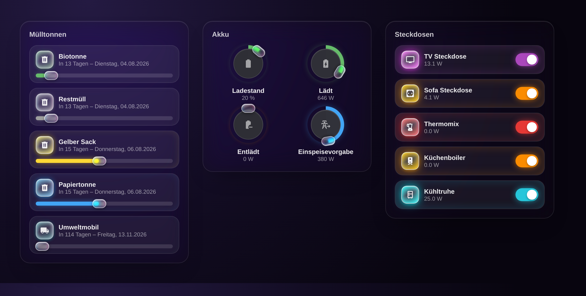
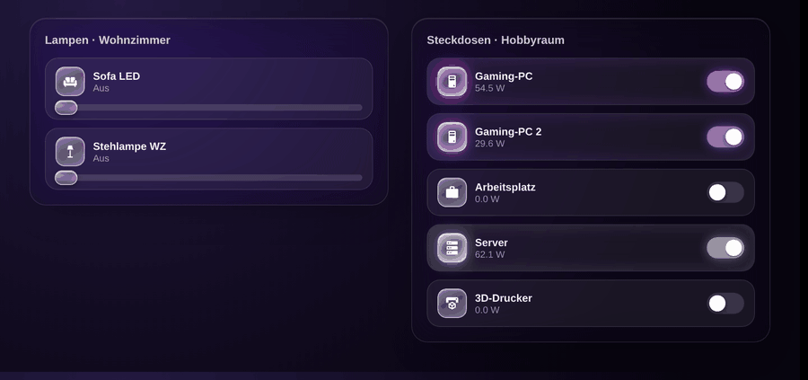

# Liquid Glass Tile Card v2

A custom [Home Assistant](https://www.home-assistant.io/) Lovelace card: one glassmorphic "liquid glass" card that holds **multiple entity rows** (toggle pills, progress bars, or ring gauges), each with a draggable glass lens for adjustable entities.

This is the sequel to [`liquid-glass-tile-card`](https://github.com/donsebby/liquid-glass-tile-card) (one entity per tile). Where v1 is a single square/chip tile per entity, v2 is a **list-style card** — one card, many rows — useful for grouping several related entities (a room's lights, a device's status fields, a room's window sensors) without stacking a dozen separate cards.

Built iteratively in conversation with Claude (Anthropic).




## Features

- Four row styles:
  - **toggle** — icon + name + status, with a real switch widget for controllable domains (`light`, `switch`, `input_boolean`, `fan`, `siren`); read-only status pill for everything else (`binary_sensor`, plain `sensor`, ...)
  - **bar** — horizontal progress track with a draggable glass lens, for brightness/percentage-style values
  - **gauge** — circular ring gauge with a draggable glass lens, same data model as `bar` in a compact ring form
  - **stat** — number-first tile for counts ("7 open items"): big value, label underneath, small icon top-right and a short accent line in the row color; value 0 dims it
- Rows are draggable (settable) whenever they represent an adjustable value (`light` brightness, `number`/`input_number`) and have no `progress` template — rows with a `progress` template are always read-only, driven entirely by the template
- Per-row JS templates (`[[[ ... ]]]`, with `states`/`hass`/`entity` in scope) for `color`, `progress`, and `state_text` — same template convention as v1
- Live color for dimmable/color lights: reads the current `rgb_color`/`hs_color` straight off live state on every update, same as v1 - no caching, no async lookups, so it can never show a stale color
- Tapping a row's name runs the row's `tap_action` if it has one, otherwise opens Home Assistant's own more-info dialog (color wheel, color temperature, etc.) - dragging the row itself only ever sets brightness/value
- Long-press (½ s) on a toggle pill always opens more-info, even when a tap toggles
- On phones, 2-column grids switch toggle pills to a Control-Center layout (icon and switch on top, name and state on their own line), so names aren't cut to a few letters
- Visual editor for title, layout, transparency and the rows themselves (templates and `tap_action` stay YAML-only)
- Confirmation dialogs (`tap_action.confirmation`) for destructive actions
- `bg_opacity` (0–1) to control how transparent the card's own backdrop reads, e.g. to match more transparent native cards on the same view
- 2-column grid layout option (`layout: "grid"`) for compact multi-row cards

## Installation

**Manual (recommended, this card isn't in HACS's default store):**

1. Add `liquid-glass-tile-card-v2.js` as a Lovelace resource:
   - Settings → Dashboards → ⋮ → Resources → Add Resource
   - URL: wherever you host the file (`/local/liquid-glass-tile-card-v2.js` if placed in `config/www/`), or add it as a HACS custom repository (category: Lovelace) pointing at this repo
   - Resource type: JavaScript Module

2. Add a card with `type: custom:liquid-glass-tile-card-v2` to any dashboard.

## Configuration

### Card

| Option | Type | Default | Description |
|---|---|---|---|
| `type` | string | — | `custom:liquid-glass-tile-card-v2` |
| `rows` | array | — | **Required.** List of row configs, see below |
| `layout` | string | `list` | `grid` arranges rows in a 2-column grid instead of a vertical list |
| `title` | string | — | Optional card title shown above the rows |
| `bg_opacity` | number | `0.7` | 0–1, controls the card's own background opacity |

### Row

| Option | Type | Description |
|---|---|---|
| `entity` | string | **Required.** Entity ID this row is bound to |
| `type` | string | `toggle` (default), `bar`, `gauge`, or `stat` |
| `name` | string | Display name, defaults to the entity's `friendly_name` |
| `icon` | string | mdi icon, defaults to the entity's own icon |
| `color` | string | Hex color, or `[[[ ]]]` template returning one (or `null`/falsy to fall back to the default) |
| `progress` | string | `[[[ ]]]` template returning 0–100. Presence of this field makes the row **read-only** regardless of domain |
| `state_text` | string | Static text or `[[[ ]]]` template for the subtext line |
| `power_entity` | string | Entity ID of a power sensor; if set, its wattage always wins over `state_text` |
| `min` / `max` | number | Bounds for `number`/`input_number` rows without a `progress` template (default 0–100). On `stat` rows, `max` makes the accent line grow with the value |
| `value` | string | `stat` rows only: number/text or `[[[ ]]]` template for the big value (default: the entity's state) |
| `hide_track` | boolean | `bar` rows only: hide the track/fill/lens, e.g. for a row that is just a tap-action button |
| `tap_action` | object | Standard-ish action object: `action` (`toggle`/`perform-action`/`navigate`/`more-info`/`none`), `perform_action`, `target`, `data`, and optional `confirmation: { text: "..." }` |

Templates run as `new Function('states', 'hass', 'entity', code)` — `entity` is this row's own state object, `states` is the full states dict, matching v1's template convention.

### Example

```yaml
type: custom:liquid-glass-tile-card-v2
layout: grid
rows:
  - entity: light.stehlampe
    type: bar
    name: Stehlampe WZ
    icon: mdi:floor-lamp
  - entity: switch.tv_steckdose
    type: toggle
    color: "#ab47bc"
    power_entity: sensor.tv_steckdose_power
  - entity: sensor.geschirrspulmaschine_programmfortschritt
    type: bar
    name: Fortschritt
    progress: "[[[ return Math.max(0, Math.min(100, parseFloat(entity.state) || 0)); ]]]"
    state_text: "[[[ return Math.round(parseFloat(entity.state) || 0) + ' %'; ]]]"
```

A pair of `stat` tiles, e.g. for a shopping list and open tasks:

```yaml
type: custom:liquid-glass-tile-card-v2
layout: grid
rows:
  - entity: todo.shopping_list
    type: stat
    name: Shopping
    icon: mdi:cart-outline
    color: "#43A047"
    tap_action: { action: navigate, navigation_path: /lovelace/shopping }
  - entity: todo.chores
    type: stat
    name: Tasks
    icon: mdi:clipboard-check-outline
    color: "#FFA726"
```

## Relationship to v1

`liquid-glass-tile-card` (v1) and this card are separate custom elements (`liquid-glass-tile-card` vs. `liquid-glass-tile-card-v2`) with different config schemas, meant to coexist rather than replace one another — v1 for a single square/chip tile per entity, v2 for grouping several entities into one list-style card. Both can be used side by side on the same dashboard.

## Theme variables

Like the other Liquid Glass cards, this card reads two optional CSS variables, so one theme can align all of them:

```yaml
# in your Home Assistant theme
lg-radius: 22px                          # corner radius of the glass panel
lg-backdrop: blur(22px) saturate(180%)   # blur/saturation behind the panel
```

Without them nothing changes. Options set on the card itself (e.g. `blur`) still win.

## Changelog

### 2.11.0
- New row type `stat`: a number-first tile (big value, label, small icon, short accent line in the row color). The value comes from the entity state or a `value` template; with `max` the accent line grows with it. Value 0 dims the tile. Whole tile is the tap target; long-press opens more-info.

### 2.10.1
- Reads the optional theme variables `--lg-radius` and `--lg-backdrop` (see *Theme variables*).
- Phones: in `layout: grid`, toggle pills narrower than ~430px card width switch to a Control-Center layout (icon + switch on top, name/state full width underneath), so long names are no longer cut to a few characters. Uses a CSS container query; wider cards look exactly as before.
- Long-press (500 ms) on a toggle pill opens more-info (with a haptic tick); moving the finger cancels it, and the tap that ends a long-press no longer also toggles.
- Subtext is truncated with an ellipsis instead of wrapping, and pills no longer trigger text selection/callouts on long-press in iOS.
- Hash navigation (`navigation_path: "#popup"`) uses `history.pushState` + a manual `hashchange`, fixing a brief reload/flash of the dashboard in the iOS Companion App (same fix as liquid-lens-navbar-card 1.5.3).
- Templates are compiled once per template string and cached instead of on every Home Assistant update.

### 2.10.0
- Visual editor (`liquid-glass-tile-card-v2-editor`) for title, layout and `bg_opacity`, plus rows (entity picker, type, name, icon, min/max, `hide_track`) with add/remove/reorder.
- Name tap runs a row's own `tap_action` when one is configured (more-info otherwise); the icon of `toggle` rows is tappable for any row with a `tap_action`, not only lights.
- New `hide_track: true` for `bar` rows.

### 2.9.3
- Fixed: gauge rows (`type: gauge`) now render the inner ring with a translucent glass surface instead of a flat, opaque theme-colored disc. `.ring-inner` previously used `background: var(--card-background-color, ...)`, which read as a solid "milky" circle rather than glass. Now uses a low-opacity white fill (`rgba(255,255,255,0.11)`) with a thin border and top/bottom inset shadows for highlight + depth, matching the round-glass look used elsewhere in the Liquid Glass family (e.g. thermostat-glass-card's `.icon-glass`). Purely visual, no config or behavior changes.

### 2.9.0
- Rewrote row rendering from a full `innerHTML` rebuild on every Home Assistant update to incremental DOM patching (existing row elements are updated in place, never replaced) - matches v1's approach
- Drag protection is now scoped per-row instead of globally: dragging one row's slider/ring no longer freezes every other row's updates
- Icon and tile glow are now plain CSS driven off `var(--c)` instead of JS-computed `color-mix()` strings, so they can never lag behind the row's current color, even mid-drag
- Fixes a bug where a light's tile/icon could briefly (or, in some cases, persistently until the slider was released) show the wrong color after a dashboard view or popup was freshly opened
- Added: tapping a row's name opens the entity's more-info dialog

### 2.8.7 and earlier
- Initial multi-row release (toggle/bar/gauge rows, templates, grid layout, `bg_opacity`)

## License

MIT
